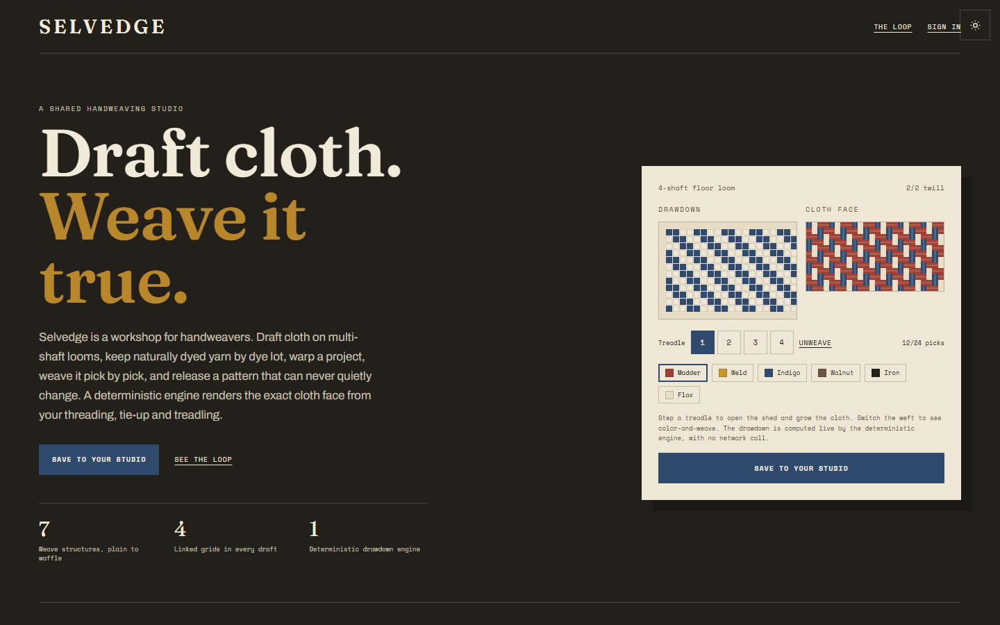
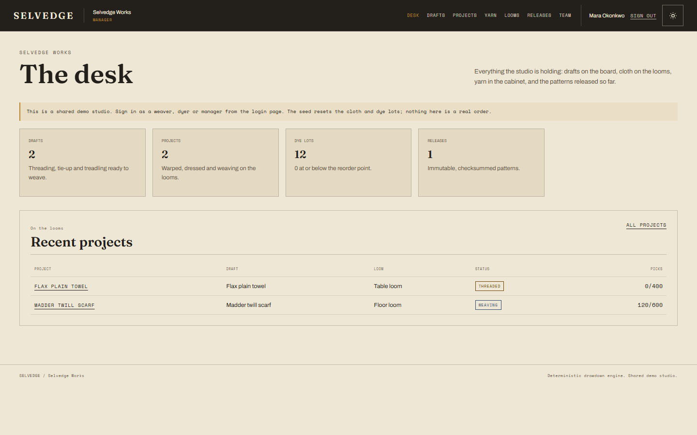
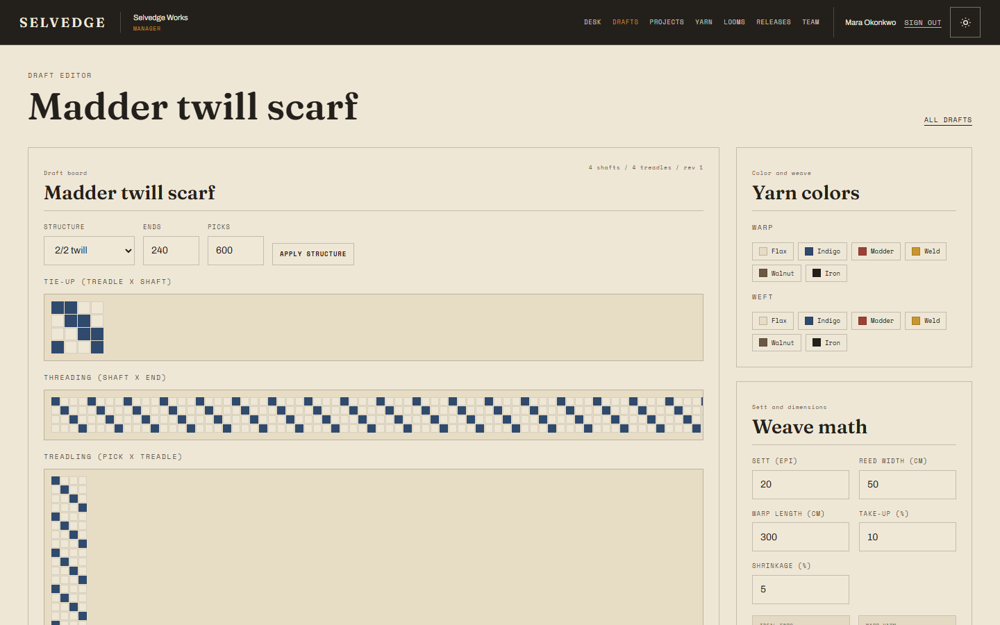
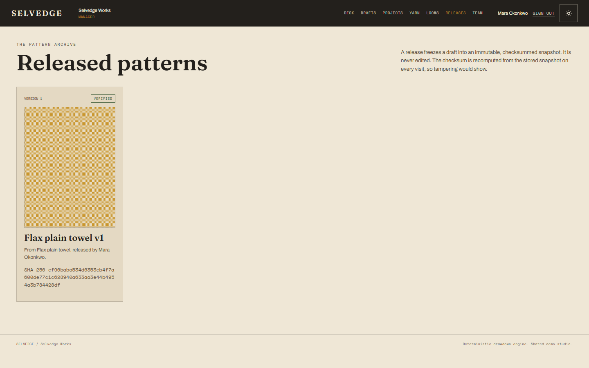

# SELVEDGE

A shared handweaving studio: draft cloth on multi-shaft looms, keep naturally dyed yarn by dye lot, warp projects, weave pick by pick, and release patterns that can never quietly change.

[](https://selvedge-app.vercel.app)
[](https://github.com/devtechedge/selvedge/actions/workflows/ci.yml)


## Live Demo

**https://selvedge-app.vercel.app**

> The public demo is a seeded, shared studio. Sign in as a weaver, dyer or studio manager from the login page, or explore the landing loom with no account. Its cloth and dye lots reset when the seed is run; nothing here is a real order. The drawdown engine itself is deterministic and makes no network call.

## Screenshots

| Landing loom | Studio desk |
|---|---|
|  |  |

| Draft editor | Released patterns |
|---|---|
|  |  |

## Features

- **Deterministic drawdown engine.** Threading, tie-up and treadling produce the exact cloth face. Seven structures: plain, 2/2 and 3/1 twill, 5-end satin, basket, herringbone and waffle. Property-based tests pin the weave laws.
- **Four linked grids.** A keyboard-first draft editor with ARIA grid semantics, structure generators, and color-and-weave yarn pickers.
- **Cloth preview.** Canvas rendering with over/under shading so twill diagonals and satin floats read correctly, from thread level to cloth level.
- **Atomic yarn inventory.** Reserving yarn is a conditional decrement inside a transaction with a `lengthOnHandM >= 0` check backstop, so two projects can never overdraw one dye lot.
- **Loom scheduling.** A draft only dresses a loom with enough shafts and treadles, enforced on the server.
- **Revision-checked autosave.** A stale save is rejected, never silently overwriting a newer draft.
- **Immutable releases.** A draft freezes into a versioned, SHA-256 checksummed snapshot over canonical JSON; tampering fails verification.
- **Role-scoped studio.** Weaver, dyer and manager roles enforced in services and actions, not just hidden buttons.
- **Weave math.** Sett, reed width, warp length, take-up and shrinkage predict finished dimensions and yarn consumption, with units.
- **Workshop chrome.** Natural-dye palette, self-hosted Fraunces / Archivo / Space Mono, light and dark themes, overlay hover-reveal scrollbars, and zero serious axe violations.

## Stack

| Layer | Choice |
|---|---|
| Framework | Next.js 16 App Router, React 19 |
| Language | TypeScript (strict) |
| Data | Prisma 7, Neon PostgreSQL |
| Auth | HMAC-hashed session tokens, scrypt passwords |
| Validation | Zod |
| Unit / property | Vitest, fast-check |
| Browser / a11y | Playwright, axe-core |
| Fonts | Self-hosted Fraunces, Archivo, Space Mono |

## Quick start

```bash
npm ci
cp .env.example .env
# Fill DATABASE_URL, DATABASE_URL_UNPOOLED and SESSION_PEPPER for a Postgres or Neon database.
npx prisma migrate deploy
ALLOW_PROD_SEED=1 npm run db:seed   # seed a local or demo database only
npm run dev
```

Run the checks:

```bash
npm run lint
npm run typecheck
npm test          # unit + integration against a *_test database
npm run e2e       # production build + Playwright journeys + axe
```

The seed refuses any database whose name is not a test/e2e/demo target unless `ALLOW_PROD_SEED=1` is set.

## License

MIT. See [LICENSE](LICENSE).